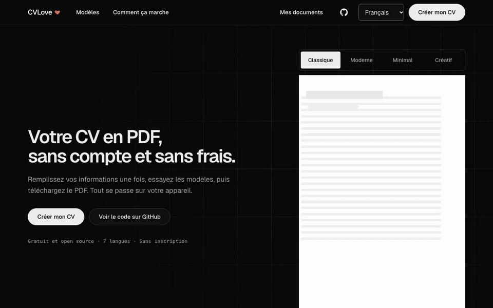
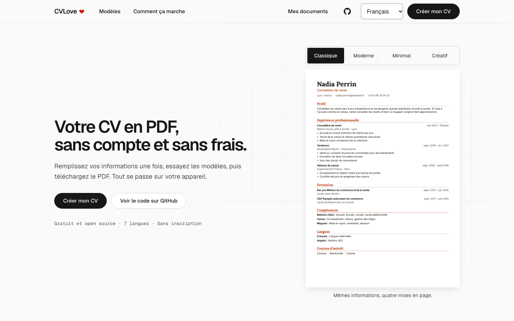
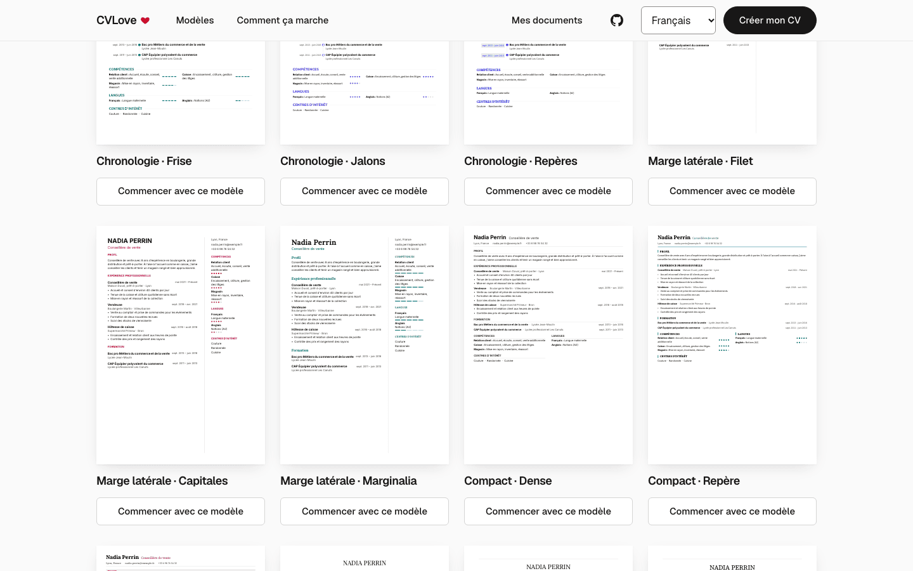
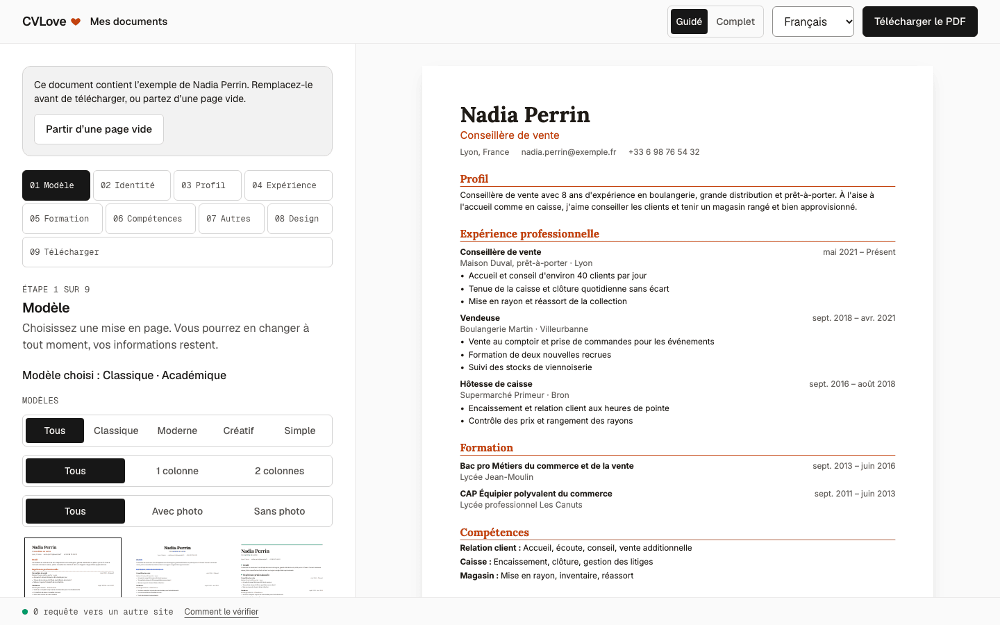
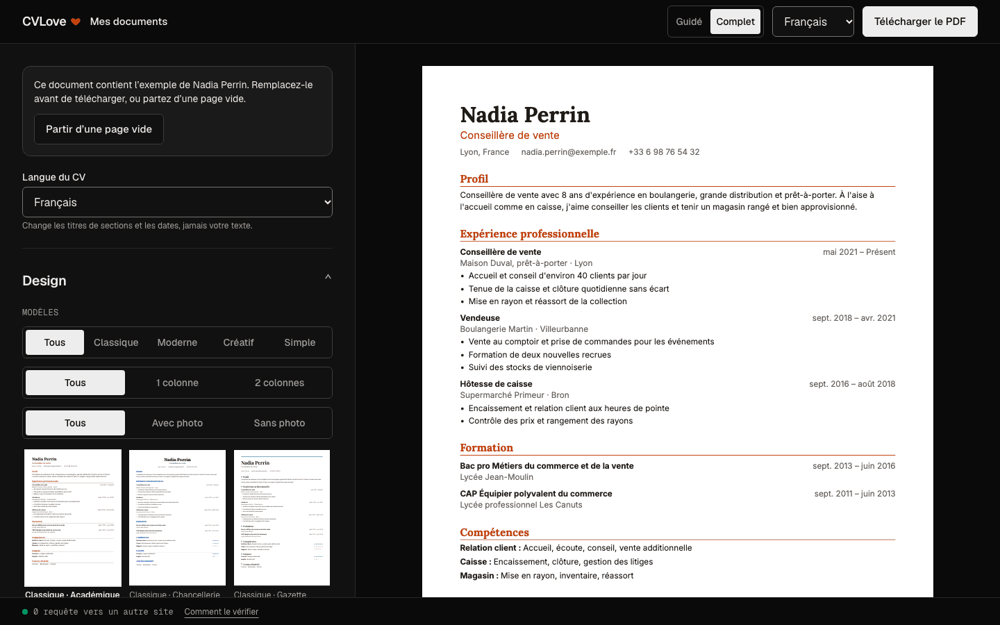
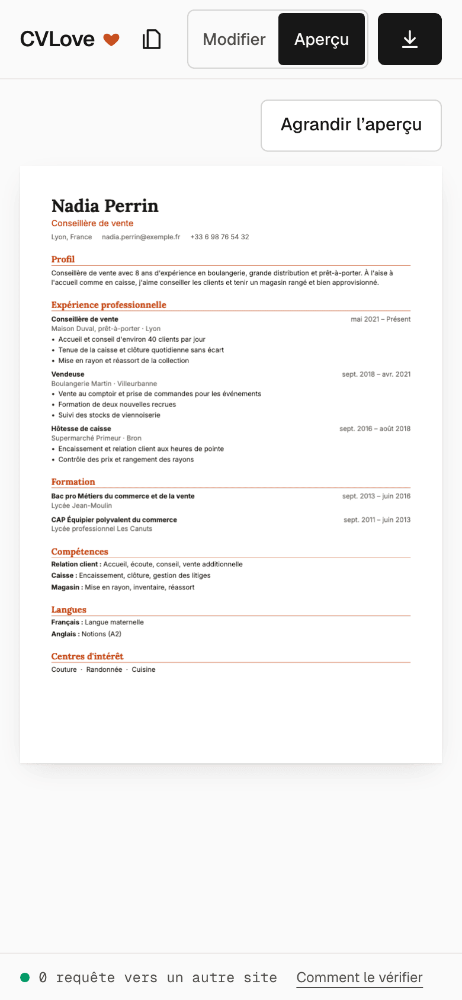

[English](README.md) | Français

# CVLove

CVLove est un générateur de CV gratuit et open source. Vous choisissez un modèle, vous remplissez vos informations et vous téléchargez un PDF. Il n'y a ni compte, ni publicité, ni serveur applicatif.



## Captures

| Accueil | Catalogue des modèles |
| --- | --- |
|  |  |

| Éditeur guidé | Mode sombre |
| --- | --- |
|  |  |

Affichage mobile (onglets Modifier et Aperçu) : 

## Confidentialité

Tout reste sur votre appareil.

- Vos documents sont enregistrés dans le `localStorage` de votre navigateur. Rien n'est envoyé à un serveur.
- Le PDF est fabriqué dans le navigateur avec `@react-pdf/renderer`. L'aperçu est ce même PDF, dessiné avec pdf.js.
- L'hébergeur ne sert que des fichiers statiques. La politique de sécurité (CSP) de `vercel.json` limite l'application à sa propre origine (`connect-src 'self' data:`).
- Les photos sont redimensionnées dans le navigateur et gardées en data URL. Les polices sont auto-hébergées.
- L'export et l'import passent par un fichier JSON que vous conservez.

Pour le vérifier, ouvrez les outils du navigateur (F12, ou Cmd+Option+I sur Mac), allez dans l'onglet Réseau et rechargez la page. Toutes les lignes viennent de l'adresse que vous avez ouverte. L'éditeur affiche aussi en bas un compteur « 0 requête vers un autre site » qui lit la même liste en direct. Les tests de bout en bout échouent si l'application contacte un autre hôte que localhost.

## Fonctionnalités

- Accueil sur `#/`, éditeur sur `#/editeur`, liste des documents sur `#/documents`, lettre de motivation sur `#/lettre`.
- Éditeur à deux modes : Guidé (9 étapes, avec de courts conseils pour un premier CV) ou Complet (un seul formulaire).
- Tant que le CV est vide, l’aperçu montre un exemple dans le modèle choisi. Trois exemples peuvent être chargés : vente et accueil, premier emploi, informatique.
- L’accueil propose de reprendre le CV en cours.
- 36 modèles, soit 12 mises en page avec 3 styles chacune. Changer de modèle conserve vos données.
- 7 couleurs d'accent et un sélecteur de couleur libre, 6 paires de polices, taille du texte, interligne, marges, A4 ou Letter, forme de la photo, affichage des niveaux de compétence.
- Sections : profil, expérience, formation, compétences, langues, projets, centres d'intérêt, section libre. Vous pouvez les ajouter, les masquer, les renommer et les réordonner.
- Photo facultative, champs personnels masquables ou personnalisés.
- Mes documents : plusieurs CV et lettres, avec dupliquer, renommer, supprimer, export et import JSON.
- Lettre de motivation avec 3 mises en page.
- Aperçu PDF en direct. Le fichier téléchargé s'appelle `CV-Prenom-Nom.pdf`.
- Mode sombre, navigation au clavier, affichage mobile.

## Langues

La langue du CV et la langue de l'interface sont indépendantes. Sept langues sont disponibles pour les deux : français, anglais, espagnol, allemand, italien, portugais et arabe (de droite à gauche). Changer la langue du CV change les libellés et les formats de date, jamais ce que vous avez saisi.

## Lancer en local

Il faut Node et pnpm.

```sh
pnpm install
pnpm dev            # serveur de développement, http://localhost:5173
pnpm build          # vérification des types, puis build de production dans dist/
pnpm preview        # sert dist/ sur http://localhost:4173
pnpm test           # tests unitaires (Vitest)
pnpm check:pdf      # rend chaque modèle dans chaque langue, vérifie le texte extrait, écrit des PNG dans out/
pnpm test:e2e       # build, puis tests Playwright (Chromium)
pnpm demo:gif       # enregistre le GIF du parcours (preview lancé et ffmpeg requis)
```

Au premier lancement des tests de bout en bout, installez le navigateur avec `pnpm exec playwright install chromium`.

## Ajouter un modèle

Les contributions sont bienvenues : nouveaux modèles, nouvelles fonctionnalités, corrections et traductions. Une nouvelle mise en page tient dans un seul fichier.

1. Copiez le fichier le plus proche dans `src/templates/layouts/` (`classique.tsx` pour une colonne, `moderne.tsx` pour deux).
2. Modifiez son `meta` (id égal au nom du fichier, noms par langue, catégorie, colonnes, 3 styles) et la mise en page elle-même. Utilisez `makeTheme` pour que votre mise en page suive les réglages de design de l'utilisateur.
3. Le registre prend le fichier en compte automatiquement via `import.meta.glob`. Vous ne le modifiez pas.
4. Lancez `pnpm check:pdf` et regardez les PNG dans `out/`.

Les règles complètes et les critères d'acceptation sont dans [CONTRIBUTING.md](CONTRIBUTING.md). Le contrat des modèles est documenté dans `src/templates/types.ts`.

## Limites connues

- Le texte extrait d'un PDF en arabe n'est pas correct. Cela vient de `@react-pdf/renderer`. La page est bien affichée, mais le copier-coller ou les logiciels de tri de CV (ATS) obtiennent un texte erroné.
- Dans les mises en page Moderne et Colonne pleine, la colonne latérale n'apparaît qu'en page 1.

## Licence

Le code est sous licence MIT (voir `LICENSE`). Les polices de `public/fonts` sont sous licence SIL Open Font License 1.1, avec les textes de licence à côté.
