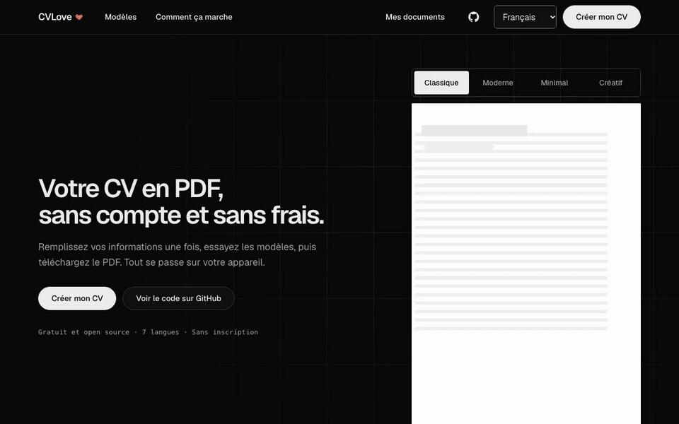
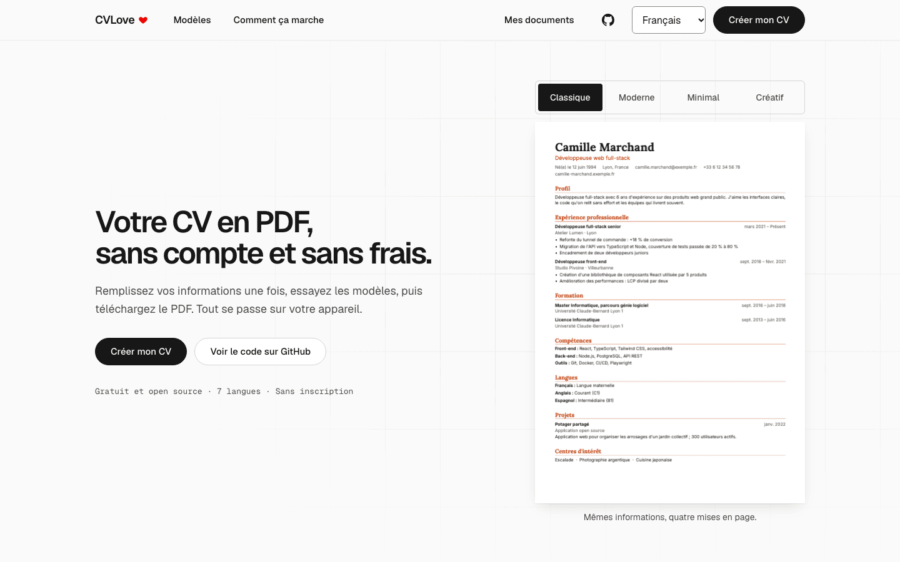
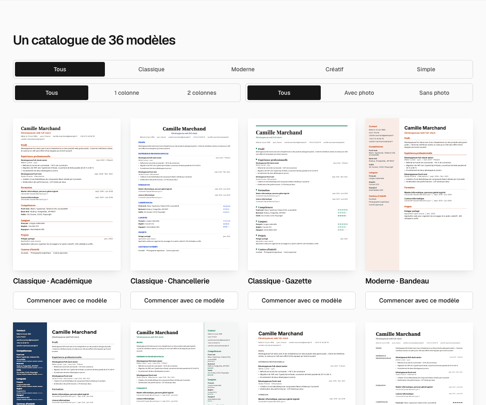
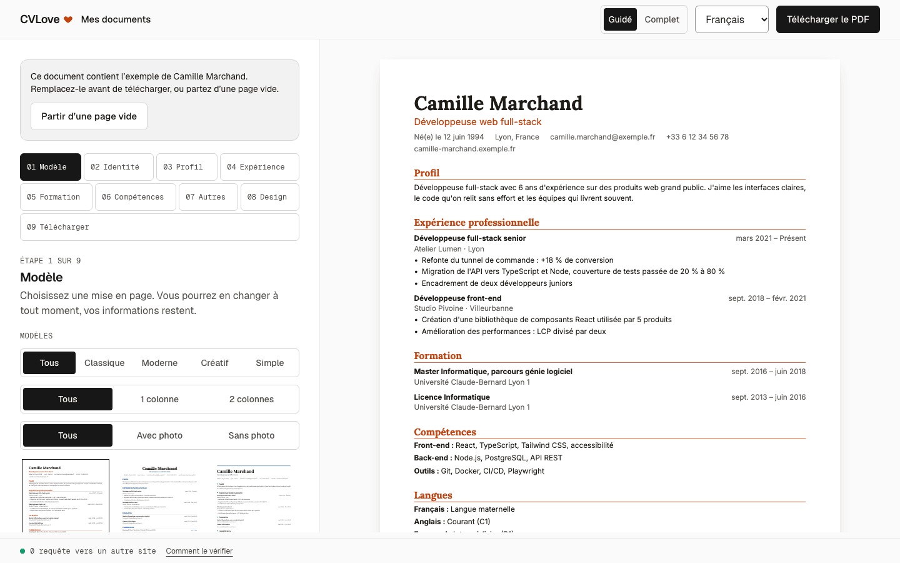
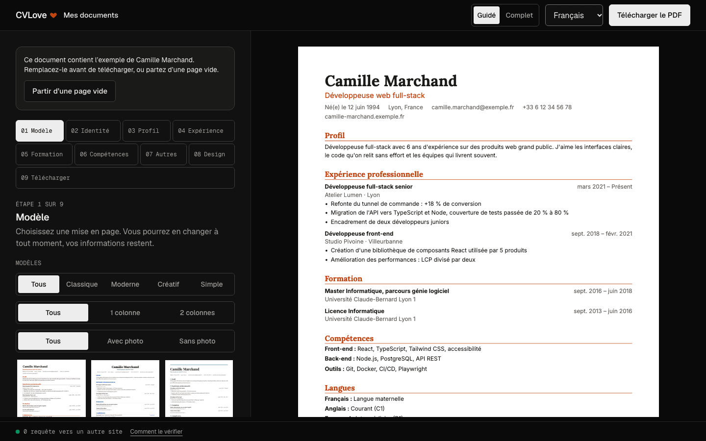
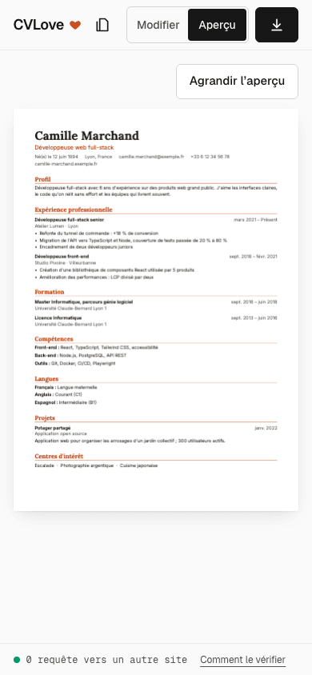

[Français](README.fr.md) | English

# CVLove

CVLove is a free, open source résumé builder. You pick a template, fill in your details and download a PDF. There is no account, no ads and no backend.



## Screenshots

| Home | Template catalog |
| --- | --- |
|  |  |

| Guided editor | Dark mode |
| --- | --- |
|  |  |

Mobile layout (Edit and Preview tabs): 

## Privacy

Everything stays on your device.

- Your documents are stored in your browser's `localStorage`. Nothing is sent to a server.
- The PDF is generated in the browser with `@react-pdf/renderer`. The live preview is the same PDF, drawn with pdf.js.
- The host only serves static files. The Content Security Policy in `vercel.json` limits the app to its own origin (`connect-src 'self' data:`).
- Photos are resized in the browser and kept as data URLs. Fonts are self-hosted.
- Export and import use a plain JSON file that you keep.

To check it yourself, open the browser developer tools (F12, or Cmd+Option+I on a Mac), go to the Network tab and reload the page. Every line comes from the address you opened. The editor also shows a counter at the bottom, "0 requests to other sites", that reads the same list live. The end-to-end tests fail if the app contacts any host other than localhost.

## Features

- Home at `#/`, editor at `#/editeur`, document list at `#/documents`, cover letter at `#/lettre`.
- Editor with two modes: Guided (9 steps) or Full (one form).
- 36 templates, made of 12 layouts with 3 styles each. Switching template keeps your data.
- 7 accent colors plus a free color picker, 6 font pairs, text size, line height, margins, A4 or Letter, photo shape, skill level display.
- Sections: profile, experience, education, skills, languages, projects, interests, free section. You can add, hide, rename and reorder them.
- Optional photo, hideable or custom personal fields.
- My documents: several résumés and letters, with duplicate, rename, delete, and JSON export and import.
- Cover letter with 3 layouts.
- Live PDF preview. The download is named `CV-FirstName-LastName.pdf`.
- Dark mode, keyboard navigation, mobile layout.

## Languages

Résumé language and interface language are independent. Seven languages are available for both: French, English, Spanish, German, Italian, Portuguese and Arabic (right-to-left). Changing the résumé language changes labels and date formats. It never changes what you typed.

## Run locally

You need Node and pnpm.

```sh
pnpm install
pnpm dev            # development server, http://localhost:5173
pnpm build          # type check, then production build in dist/
pnpm preview        # serve dist/ on http://localhost:4173
pnpm test           # unit tests (Vitest)
pnpm check:pdf      # renders every template in every language, checks the extracted text, writes PNGs to out/
pnpm test:e2e       # builds, then runs the Playwright tests (Chromium)
pnpm demo:gif       # records the walkthrough GIF (needs preview running and ffmpeg)
```

On the first end-to-end run, install the browser with `pnpm exec playwright install chromium`.

## Add a template

Contributions are welcome: new templates, new features, fixes and translations. A new layout is one file.

1. Copy the closest file in `src/templates/layouts/` (`classique.tsx` for one column, `moderne.tsx` for two).
2. Edit its `meta` (id equal to the file name, names per language, category, columns, 3 styles) and the layout itself. Use `makeTheme` so that your layout follows the user's design options.
3. The registry picks the file up automatically through `import.meta.glob`. You do not edit it.
4. Run `pnpm check:pdf` and look at the PNGs in `out/`.

The full rules and the acceptance criteria are in [CONTRIBUTING.md](CONTRIBUTING.md). The template contract is documented in `src/templates/types.ts`.

## Known limits

- Text extracted from a PDF in Arabic is not correct. This comes from `@react-pdf/renderer`. The page looks right, but copy and paste or ATS parsers get wrong text.
- In the Moderne and Colonne pleine layouts, the side column appears on page 1 only.

## License

The code is under the MIT license (see `LICENSE`). Fonts in `public/fonts` are under the SIL Open Font License 1.1, with the license texts next to them.
