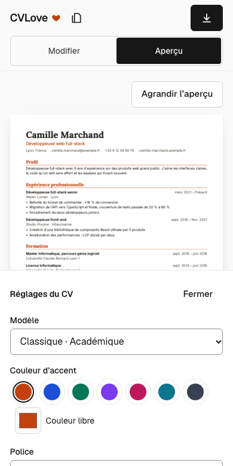

# Réglages dans l'onglet Aperçu (mobile)

2026-11-11, base `8f4a55c`. Suite du P2 de la [synthèse du panel](panel-synthese.md).

Sous 1024 px, l'onglet Aperçu a une barre collée en bas avec un bouton « Réglages ». Il ouvre un tiroir qui reprend le modèle, la couleur, la police, la taille du texte et « Tenir sur 1 page ». Sur bureau, rien ne change.

Décisions :
- Tiroir plutôt que barre de curseurs : cinq contrôles ne tiennent pas sur une ligne à 360 px avec des cibles de 44 px.
- Tiroir non modal, 42 % de la hauteur (`dvh`) : la feuille reste visible au-dessus, et un espace de même hauteur est ajouté sous elle pour qu'on puisse la faire défiler jusqu'en bas. Pas de fond grisé ni de piège à focus.
- Contrôles réutilisés : `DesignSettings` (`src/ui/DesignPanel.tsx`) reçoit une prop `quick` qui masque interligne, marges, format, photo et compétences. Sans la prop, rien ne change. Modèle : une liste déroulante des 36 modèles (la grille de vignettes est trop haute pour un tiroir), même action que la galerie.
- Lettre : même tiroir, sans liste de modèles ; `DesignSettings` y garde le choix de mise en page.
- Fermeture : Échap (depuis n'importe où), bouton « Fermer ». Le focus passe sur « Fermer » à l'ouverture et revient au bouton d'ouverture à la fermeture.
- RTL : propriétés logiques (`inset-x`, `-mx`), le tiroir hérite de `dir`.
- Libellés (7 langues) : `src/i18n/previewSettings.ts`.
- Code : `src/ui/PreviewSettings.tsx`, branché par la prop `settings` de `PreviewPane`.
- Test : `tests/e2e/reglages-apercu.spec.ts` (360 px : cibles, effet, Échap, bouton, focus, débordement ; arabe ; bureau sans bouton).
- Non vérifié : rendu à l'œil en arabe et en allemand (textes longs), appareil réel, clavier virtuel.
